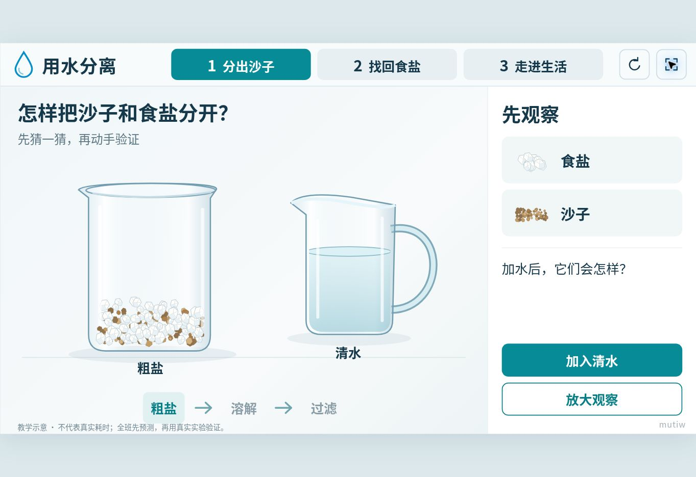

# 三上2.8《用水分离》· 互动实验室 v1.0

依据本项目提供的三年级上册教材第51—53页和教师教学用书《第8课 用水分离》制作。用于教师引导、学生触控和真实实验前后的观察讨论。共3页，不包含整节课的讲授课件。

## 三页功能

1. **分出沙子**：粗盐加水、搅拌溶解；依次放入湿滤纸、摆放玻璃棒、让漏斗下端贴杯壁；预测并观察过滤结果。可打开注明模型含义的放大示意，看到溶解的食盐随水通过，沙子留在滤纸上。
2. **找回食盐**：加热或自然蒸发；快干时停止加热、余热蒸干、冷却后比较粗盐与分离所得食盐；再加水验证食盐可重新溶解。真实实验由教师指导，点火由教师操作。
3. **走进生活**：盐田晒盐的时间推进；教材分层过滤器的观察、重新装配、过滤和判断。过滤器从上到下为砂砾、粗沙、细沙、棉花、细纱布。

## 课堂操作

- 右上角全屏按钮，或按 F11；顶部可随时切换页面，左右方向键也能切换。
- 所有必要流程均有大按钮入口。第一页还可以在烧杯中拖动搅拌、触碰器材完成装配。
- 右上角重置按钮只重新开始当前页面。离开一页时动画暂停，返回后可继续。
- 以1600×900逻辑画面等比例适配窗口，主内容不需要滚动；手机横屏观看更清楚。

## 科学含义

- 食盐溶解后仍在水中。蓝点仅是模型，不是肉眼看得见的盐粒。
- 过滤留下沙子，流下的是盐水；过滤不会去除已溶解的食盐。
- 蒸发离开的是水，盐留在容器中；箭头表示水分离开，水蒸气本身不可见。
- 蒸发快干时先停火，用余热蒸干；冷却后再观察。实验盐不能品尝。
- 食盐颗粒的大小和形状可以变化；不以外观完全相同作为判断依据。
- 简易过滤只能去除部分杂质。看起来清澈不等于可直接饮用，溶解物和部分微生物可能仍在。
- 所有过程均为教学示意，动画时间经过压缩，不代表真实实验耗时或定量过滤效率。

## 文件与运行

`index.html` 为完整单文件，内含样式、脚本和SVG图形，无框架、CDN、外部字体、图片、WebGL或网络请求依赖。下载后可用浏览器直接打开。建议在实际希沃一体机上使用浏览器全屏模式；本次浏览器验收不能替代每一种希沃硬件与内置浏览器版本的实机测试。

网页版：https://mutiwangn.github.io/AI-html/三上2.8用水分离/

## 验证记录

已在浏览器中实际操作溶解与过滤全流程、快干停火与余热蒸干、冷却与比较、再次溶解、自然蒸发、跨页暂停/继续、盐田进度、五层滤材重装、过滤与饮水判断。主界面及较多文字的结果状态均检查侧栏未溢出。

已通过嵌入式浏览器视口检查1920×1080、1600×900、1280×720、1024×768及390×844布局；4∶3窗口保留上下留白，竖屏提供横屏提示。本次云端浏览器限制Fullscreen请求，已验证F11回退提示；尚未在真实希沃硬件上测试。

视觉对照检查覆盖导航/文案、字号与层级、浅色底与青绿强调色、主舞台与侧栏比例、器材及按钮状态。为保证科学表达和动态操作，最终器材使用精确SVG示意，移除了设计效果图中没有实测依据的刻度，并按课堂文字长度调整字号。

