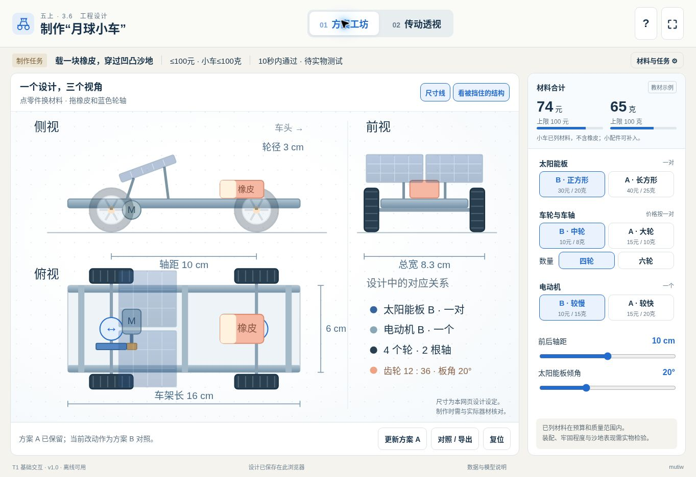

# 五上3.6 制作“月球小车”

本课网页用于辅助学生把设计图、材料选择与内部传动联系起来，支持制作前的方案讨论和制作中的问题诊断。实物组装与沙地测试仍在课堂中完成。

## 教材依据

- 《科学》五年级上册第三单元《运动和力》第6课，教材印刷页86—89（项目PDF第90—93页）。
- 教师教学用书第6课（目录起始页263）：本课重点是明确任务、制订方案和实施方案；测试改进与展示交流主要在第7课展开。
- 配套材料说明书印刷页22（项目PDF第13页右栏）提出在阳光下调整太阳能板角度，观察小车运动。

教材的参考任务是：载1块橡皮，在10秒内通过凹凸不平的测试沙坑；材料价格不超过100元，小车质量不大于100克。教材明确说明这些指标可按学校实际调整，100元为虚拟示例。

## 两个工作区

### 设计工作区

通过同步更新的俯视、侧视和正视SVG图，观察同一设计的不同投影。选择太阳能板、电动机、车轮及4轮或6轮结构，调整轴距、橡皮位置和太阳能板角度，检查部件位置与尺寸关系。

材料价格、质量和任务上限可由教师修改。支持保存A方案与当前B方案比较、导出SVG设计单、导入与导出JSON方案，以及浏览器本地保存。三视图是二维正投影视图，并非可自由旋转的三维模型。

### 传动透视工作区

观察太阳能板、导线、电动机、齿轮、车轴与车轮的联系。切换断路、遮光和齿轮脱开状态，区分不同环节中断时的现象；可选择12齿主动轮配12、24或36齿从动轮，通过暂停与单圈观察比较转动方向和转数。

## 材料计数与示例

下表使用教材88页的示例价格和质量，均可按实物修改。太阳能板按一对计；车轮与车轴按一对计，四轮车使用两对，六轮车使用三对；传动齿轮按两只计。

| 材料 | 单位 | 质量 | 价格 |
| --- | --- | ---: | ---: |
| 太阳能电池A | 对 | 25克 | 40元 |
| 太阳能电池B | 对 | 20克 | 30元 |
| 车轮A＋车轴A | 对 | 10克 | 15元 |
| 车轮B＋车轴B | 对 | 8克 | 10元 |
| 车身支架 | 套 | 10克 | 10元 |
| 小电动机A | 个 | 20克 | 15元 |
| 小电动机B | 个 | 15克 | 10元 |
| 齿轮 | 只 | 2克 | 2元 |

在四轮、一对太阳能板、一台电机、一个支架和两只齿轮的条件下，全部选B的合计为**74元、65克**，全部选A的合计为**99元、79克**。上述质量不包含作为载荷的橡皮。教材没有列出工具质量；价格与质量合计只覆盖清单中的材料，不能替代成品称量。

## 模型与现实的边界

- 轮A直径5厘米、轮B直径3厘米、车架16×6厘米，以及可调尺寸范围，均为网页模型设定，不是教材提供的完整实物规格。
- 教材太阳能电池的“能量5/3”没有标明单位，网页不将其解释成5瓦/3瓦或5伏/3伏。
- 相邻外齿轮转向相反；从动轮转速按主动齿数与从动齿数之比计算。12齿带36齿时，主动轮转3圈，从动轮转1圈。暂停与单圈观察用于呈现这一传动关系，不能据此预测真实沙地车速。
- 光照与通断状态呈现能量输入和连接关系的简化示意，不提供未经校准的真实电压、电流或电动机性能预测。电机启动能力还受实际光照、电路、负载和器材差异影响。
- 网页不模拟真实通过沙坑的成绩，不自动判定10秒任务是否达成。小车牵引、陷沙、打滑、结构牢固程度和制作误差需要通过实物测试检验。
- 保存方案与导出设计图用于表达和比较设计，不能代替学生讨论、实物组装与实际测量。

## 离线与技术等级

单体HTML，技术等级T1，使用HTML、CSS、SVG与原生JavaScript，核心功能无需网络、WebGL或外部素材。下载后可离线打开；本地保存与文件导入导出能力受浏览器设置影响。此处不构成对未测试设备或浏览器的兼容性承诺。

## 科学参考

[LEGO Education：Gear](https://education.lego.com/en-us/lessons/spm/gear/)介绍齿轮齿数比、转动方向，以及转速与输出转矩之间的权衡。

## 验证记录

2026-11-06：

- 实际运行于云端 Chromium。检查1363×936桌面视口及1024×768嵌入视口，两工作区核心控件可见，1024横屏侧栏无内部滚动。
- 浏览器操作检查：选材与预算/质量超限、四轮/六轮切换、轴距直接拖动、橡皮方向键移动、A/B对照、材料上限修改、恢复设置、刷新后本地状态恢复、页面切换。
- 实际观察12:36单圈结果为电机1.00圈、车轮0.33圈；齿轮脱开后电机增至2.00圈，车轮仍为0.33圈；断路反馈正常。
- Node状态机校验覆盖12:12/24/36单圈比例、断路、全遮光、齿轮脱开、重新啮合清零、隐藏时暂停、中心距与齿数联动。
- Node执行验证四类材料组合合计与车轮数量；SVG/JSON导出内容生成、特殊字符转义、长备注及附加配件边界通过，SVG通过XML解析。浏览器已触发下载，但此远程环境未返回下载文件，未据此宣称下载落盘验证成功。
- 未在真实希沃一体机或iPad Safari上运行；T1表示技术需求，不保证所有旧系统兼容。

## 保存与恢复保护修订
当前设计、A方案与材料设置整体校验，异常缓存保留原文并只读保护，不用默认值覆盖。支持草稿、当前原文和启动快照备份。合法文件恢复须确认且只改变当前页面，明确保存后才写本机；解除保护前须备份并确认下载可找到。替换A、恢复A与复位增加确认。读文件期间编辑或新选择会取消迟到恢复。

正常修改仍尝试延迟自动保存，准确显示待保存或失败。写前比较和跨标签提示保护已观察到的冲突，不保证 localStorage 同时写入的原子性。损坏原文可备份不代表能直接恢复。

浏览器已验证合法/无效文件、取消恢复、明确保存与刷新、A方案及说明保留、测试缓存损坏的原文备份。精确竞态、配额失败为隔离测试。本轮未全面重测机构、拖动、SVG导出及真机；科学和计价模型未改变，旧版保留于 Git 历史。
