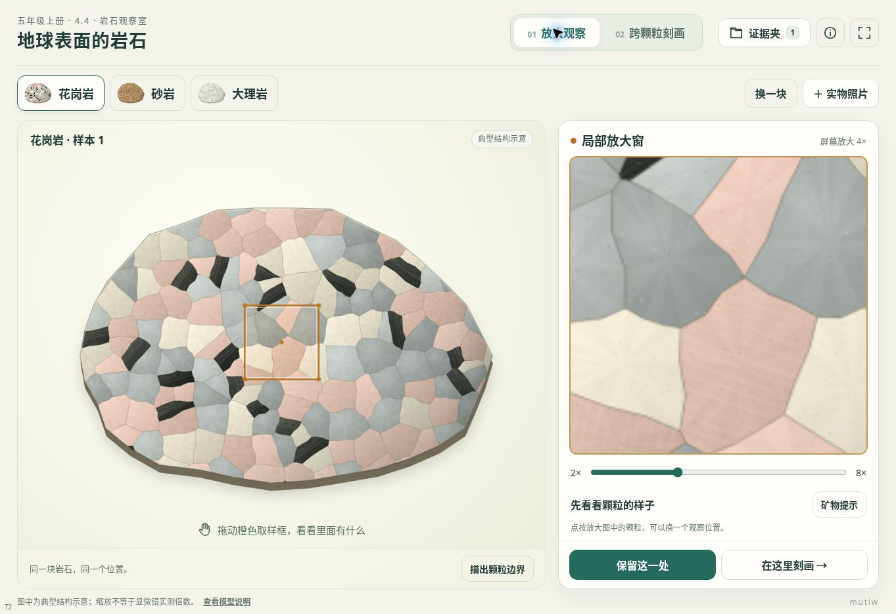

# 五上4.4《地球表面的岩石》

**v1.0 · 两个探究页面＋观察证据夹 · T2 / Canvas 2D**

入口：[打开互动网页](./index.html)。单体 HTML，必要代码与图形内嵌，无外部运行依赖，可下载后离线使用。面向教师主控的一体机横屏，兼顾平板触控。课件不显示学校和姓名，仅保留低干扰的 `mutiw` 水印。

## 教材依据与教学增益

依据本项目提供的五年级上册教材第四单元第4课，**教材110—113页、教师教学用书331—341页**。观察维度参考教材112页的记录单：颜色、颗粒粗细、坚硬程度及其他特征。本项目未使用未提供的作业本题目。

保留实物观察、放大镜和安全刻画活动。网页重点解决全班难以共同看清局部、难以准确对应颗粒位置，以及擦拭前后不便保留对照的问题。

- **放大观察：**花岗岩、砂岩、大理岩全貌与局部窗使用同一幅图，拖动取样位置即可同步观察；支持换样本、辅助边界、按需显示矿物提示和保留局部图。可导入实物照片，与结构示意并排比较。
- **跨颗粒刻画：**工具沿学生实际拖动路径逐段经过不同矿物，计算局部是否刻入。擦拭附着痕后观察哪些位置仍有沟痕，用于解释同一块花岗岩不同位置的刻画结果为何可能不同。
- **观察证据夹：**最多保留8条，任选两条并排查看，选择描述词或自行填写观察；可导出对照图片及JSON记录。页面不自动代写结论，模型记录与实物照片分别标明来源。

## 模型与参数边界

三类岩石均为人工绘制的典型结构示意，不是显微影像。花岗岩表现不同矿物相互嵌合，砂岩表现砂粒与胶结物，大理岩表现以方解石为主的晶粒。形状、颜色、颗粒比例不代表所有实物；辅助描边不是天然裂缝，不能仅凭颜色鉴定矿物。“屏幕放大”也不是显微镜实测倍率。

| 本示例工具 | 相对硬度 | 本示例矿物 | 相对硬度 |
|---|---:|---|---:|
| 指甲 | 2.5 | 黑云母 | 3 |
| 铜钥匙 | 3.5 | 长石 | 6 |
| 小刀 | 5.5 | 石英 | 7 |

以上是教学模型选值。莫氏硬度为相对等级，无单位，不表示倍数；实际钥匙合金、刀具和矿物样品有差异。黑云母常见硬度约2.5—3，与指甲接近，实物应换点复测。此处仅当工具示例硬度大于所经过矿物时留下沟痕，不给整块花岗岩或砂岩设置统一硬度。

附着痕展示一种可能情况，不能解释为每次必然出现。擦拭移除附着痕，保留模型沟痕；图像不表示真实损伤深度、敲碎或开裂。模型结果由预设规则产生，不能作为独立证明该规则的实验依据。实物小刀操作应由教师指导。

## 照片与记录

照片仅在本机页面中处理，不上传、不自动识别岩石或矿物，也不推算硬度；放大不会生成原图没有的细节。照片模式不提供矿物刻画计算，刻画页始终使用明确标识的花岗岩模型。

证据截图和学生描述保存在当前浏览器；原始导入照片不会作为完整原图自动存档。清理浏览器数据可能删除记录，需要留存时导出图片或JSON。JSON用于保存完整记录数据，当前页面未提供JSON导入恢复功能。

## 资料来源

- [英国地质调查局：岩石、矿物与颗粒结构](https://www.bgs.ac.uk/discovering-geology/rocks-and-minerals/)
- [美国国家公园管理局：莫氏硬度与比较工具](https://www.nps.gov/articles/mohs-hardness-scale.htm)
- [美国矿物学会：相对硬度、擦拭与真实划痕](https://msaweb.org/msa/Collectors_Corner/id/mineral_id_keyi4.htm)
- [明尼苏达大学：黑云母的硬度与片状特征](https://commonminerals.esci.umn.edu/minerals-f/biotite)

## 维护入口

发布文件为 `index.html`，内部按模块组织：`RockEngine.create/draw/hit` 负责结构、绘图与位置查询；`TOOLS`、`state`、`scratch` 管理参数和交互状态；观察取样、擦拭快照、证据存储与导出独立处理。替换素材时须保留绘图与命中查询的同一坐标关系，不能只换图而沿用不匹配的矿物分区。修改记录结构时注意本机存储版本兼容。

## 验证记录

已完成 JavaScript 语法检查、矿物代表点与结构命中检查。已在云端 Chrome 实际运行课堂页面：用鼠标拖动刻画、擦拭、撤销，保留并查看前后证据，填写观察文字，生成 PNG 对照图；刷新后本机证据仍可恢复。

浏览器验证覆盖三种岩石、2–8×放大、触控取样、矿物分区与三种工具的对应、局部/整体擦拭、撤销/复位、擦拭前后同区快照、照片导入、模型/照片来源标签及证据存储。1366×768、1024×768、1920×1080 两个主页面的核心操作均在一屏内，工具区无内容溢出；390×844 无横向溢出，采用纵向排列。

PNG 生成及图像预览已验证；当前自动化浏览器未获得下载落盘回执，因此不把“保存到设备”列为已通过项目。页面同时提供图像预览与另存入口。

维护用 `qa.html` 可在同目录的浏览器环境运行，检查页切换、取样、工具与局部刻痕、擦拭快照、照片模式、证据保存与导出，以及1366×768、1024×768、1920×1080、390×844布局。课堂入口为 `index.html`，运行不依赖验证页。

未在真实希沃一体机、iPad Safari或旧版安卓设备上实机测试。

## 2026-11-08 存档保护修订
读取前完整检查存档结构。异常、未知版本或其他页面已更改的数据停止自动写入，原始字节保留并可下载；当前页面仍可操作和导出作品，但不把它误称为本机已保存。保存失败显示持续提示，不被操作提示覆盖。没有删除、迁移或重命名旧存储键。此修订不包含备份导入或新副本恢复流程。

本轮存档保护测试：三课正常保存与刷新恢复已用云端 Chromium 验证；损坏 JSON、未知字段/版本、配额与权限失败、跨页变化等为独立隔离测试，非真实浏览器故障注入。未验证原文备份下载落盘、长笔迹和全部导入组合、真实希沃/iPad；跨页读后比对不等于原子并发安全。当前不支持备份导入恢复。
