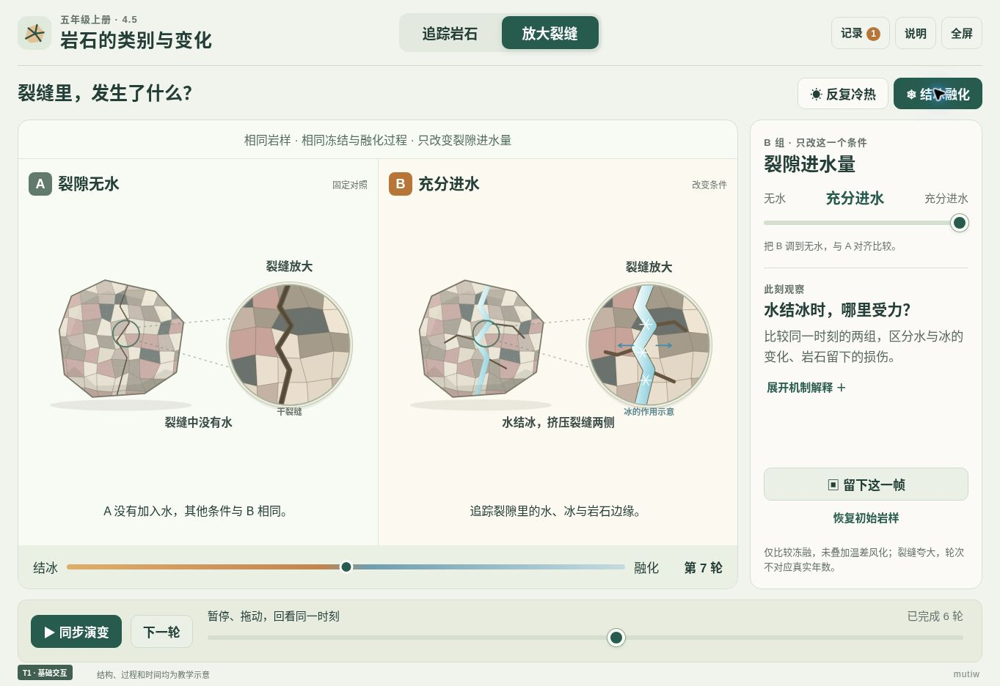

# 五上4.5《岩石的类别与变化》

**v1.0 · 两个探究页面＋观察记录 · T1 / HTML、CSS、JavaScript、SVG**

入口：[打开互动网页](./index.html)。单体 HTML，代码与图形全部内嵌，无外部运行依赖，可下载后离线打开。面向教师主控的一体机横屏，兼顾学生触控和平板探究。课件不显示学校和姓名，仅保留低干扰的 `mutiw` 水印。

## 教材依据与教学增益

依据本项目提供的五年级上册教材第四单元第5课，**教材印刷114—117页（PDF第118—121页）、教师教学用书342—352页**。本课围绕岩石的三种成因以及自然因素引起的岩石变化展开。参考教材中的成因记录和岩石变化观察任务，未使用或编造未提供的作业本题目。

保留真实岩石标本观察和教师指导下的实验活动。网页补充学生难以直接观察的内部过程、无法在一节课中经历的缓慢变化，以及不便反复回看的同位置对照。

- **追踪变化路径：**可从岩浆、岩浆岩、松散沉积物、沉积岩或变质岩出发，选择与当前材料相符的变化过程。局部放大与过程进度联动，观察冷却结晶、压实胶结、固态变质、熔化和风化破碎。学生可以暂停、拖动回看、选择分支并保存自己的路径。
- **裂缝里的时间：**比较同一岩样、同一进程的两组模型。反复冷热模式调节温差条件；结冰融化模式改变裂隙进水条件。整块岩石与内部放大图同步，帮助解释矿物变形、水与冰和裂隙变化之间的联系。改变条件后回到相同起点，支持暂停、回看与重复比较。
- **观察记录：**保存变化路径或同一时刻的A、B对照帧，并导出自包含的SVG观察图。记录明确标为教学模型，不自动替学生填写结论。

## 科学模型与适用边界

岩石按**形成原因**分类，不能仅凭颜色、条纹或单个外观特征确定类别。图形是人工绘制的典型结构示意，不是照片、显微影像或真实测量。

- 岩浆冷却结晶形成岩浆岩；松散沉积物须经过成岩作用才形成沉积岩，碎石本身不等于沉积岩。
- 变质作用主要表现为原有岩石在固态下的矿物或结构变化，不能解释成“稍微熔化”。岩石熔化后成为岩浆，再冷却结晶可形成岩浆岩。
- 岩石变化有不同路径，不要求三类岩石按固定顺序循环。本页用类别关系表达共同机制；大理岩的典型原岩是石灰岩，不能将所有原岩都解释为最终形成大理岩。
- 冷热模式突出不同矿物及岩石表里变形不同可能造成的受力与损伤。裂隙与变形被放大，不能从图像推算真实裂缝宽度、破碎阈值或发生概率；已有损伤不会因降温自动复原。
- 冻融模式只比较裂隙中水结冰、融化带来的影响，未叠加温差风化等因素。“无水”对照表示本页没有冻融作用，不代表真实无水岩石不会受到其他风化作用。
- 进度和轮次是示意模型的操作标尺，不对应自然界的真实年数，也不等于教材实验的实际次数。不能据此断言所有岩样加热冷却几次就必然开裂。

动画依据预设机制生成，只帮助观察和解释模型关系，不能作为独立验证这些规律的实验证据。真实观察应记录学生看到的现象，包含“变化不明显”的情况。教材中的加热与冷水实验应由教师组织并按教材要求采取防护。

## 记录与运行

模型运行不调用网络、不申请摄像头或麦克风。观察记录保留在当前页面会话中；刷新或关闭页面后不会自动恢复。需要留存时导出SVG文件，浏览器可直接打开，亦可用支持SVG的软件继续处理。

全屏和文件下载由浏览器决定；不支持页面全屏时可使用浏览器的全屏功能。技术等级T1表示所需技术类型，并不构成对所有设备、旧浏览器或希沃环境的实机兼容保证。

## 资料来源

- 本项目上传的《科学》五年级上册教材114—117页及教师教学用书342—352页。
- [英国地质调查局：岩石与矿物](https://www.bgs.ac.uk/discovering-geology/rocks-and-minerals/)：岩石类别与成因，以及石灰岩与大理岩的关系。
- [英国地质调查局：风化](https://www.bgs.ac.uk/discovering-geology/geological-processes/weathering/)：温度变化、裂隙中的冻融和植物等因素对岩石的作用。
- [美国地质调查局：什么是变质岩](https://www.usgs.gov/faqs/what-are-metamorphic-rocks)：变质作用与熔化的区别。

## 维护入口

发布入口为 `index.html`，内部依次包含页面结构、样式、SVG绘图模块与交互逻辑。材料、允许的变化过程、模型条件和状态独立管理；图形替换应保持整体视图、局部放大和保存帧的坐标及状态对应。调整模型时须同步检查过程说明、标签、对照条件和SVG导出内容，不能只替换动画而保留不匹配的解释。

## 验证记录

已在云端 Chromium 实际运行并操作：材料起点选择、五种变化连续追踪、保存路径、冷热与冻融切换、改变条件后复位、相同条件图形一致、同步播放与暂停、进程回看、保存双组观察帧和记录面板。

已用实际浏览器的嵌入视口检查 1366×768 课堂横屏、1024×768 平板横屏、768×1024 平板竖屏和390×844手机布局。横屏及平板无需整页滚动查找核心控件；手机将两组岩样上下排列，允许纵向滚动。

代码层面验证了阶段边界、永久裂缝不随向前进程缩小、无水冻融与零温差不新增对应损伤、同条件结果一致，以及 SVG/XML 完整性。观察图生成逻辑已实际执行并通过独立 XML 解析；页面已生成下载链接。云端预览浏览器限制临时 Blob 文件下载与打开，因此未完成该环境的下载端到端验证。

单体 HTML 源码依赖检查通过，运行无需外部脚本、字体或图片；未进行真实设备断网测试。

未在真实希沃一体机、iPad Safari或旧版安卓设备上实机测试；以上不构成已经完成这些设备测试的声明。
