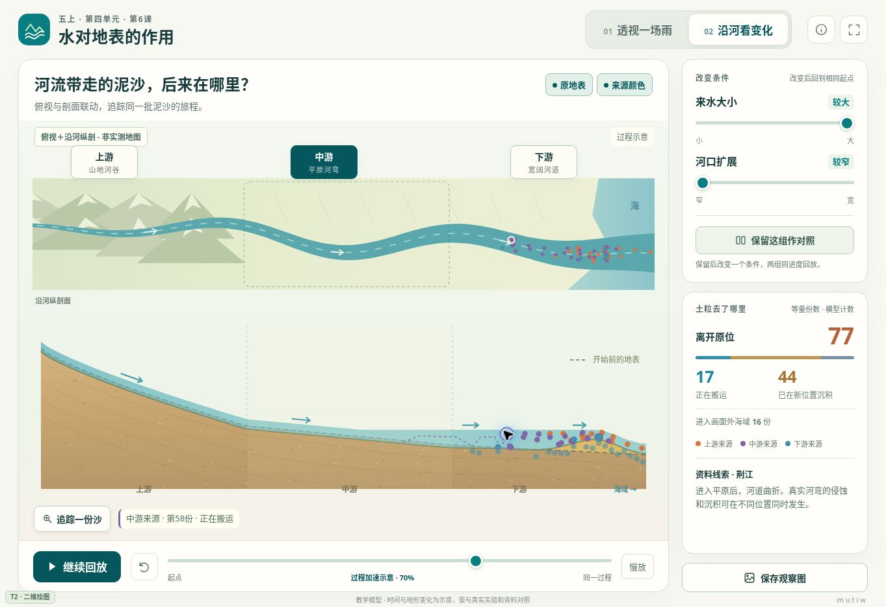

# 五上4.6 水对地表的作用

两页单体互动网页，v1.0。围绕“坡上少掉的土去了哪里”与“河流带走的泥沙后来在哪里”，用透明剖面、来源追踪、时间回看和同进度对照补充真实实验。

## 课堂使用

保留喷壶、土坡和托盘的实物实验。网页适合在实验观察之后帮助解释，也可在长江资料研讨时使用。它没有固定闯关流程，不代填真实实验记录。

### 透视一场雨

- 调整降雨强弱或坡面倾斜，观察一场降雨与随后退水的过程。
- 沿一条径流路径剖开坡面，保留开始前地表的虚线，比较降低与增高的位置。
- 点选示踪土粒，或点击“追踪一份土”，观察同一来源物质的移动与停留。
- 随时暂停、慢放或拖动进度条回看；“回到起点”保留当前条件与对照。

### 沿河看变化

- 俯视图与沿河纵剖面显示同一批示踪物质；点击上、中、下游观察位置，联系教材中的金沙江、荆江与南京段资料。
- 改变来水大小或河口扩展，比较搬运、沉积与进入画面外海域的物质去向。
- 上、中、下游不是三个过程的独占区域；模型允许同一区域有侵蚀、搬运、沉积，已沉积物质也可能再次被带走。

### 对照与观察图

点击“保留这组作对照”后，只改变一个条件。A、B的初始物质份数和回放进度一致；若改变坡度，则初始坡形随之改变。界面在同时改变两个条件时提示不能单独归因。移除对照后恢复单幅观察。

“保存观察图”生成带条件、进度、地形、来源颜色图例和模型计数的PNG，留出“我的解释”位置。浏览器不支持直接下载时可在预览中长按图片保存。图中的数值不能填写成实物实验的实测结果。

## 教材依据

- 用户提供的教科版五年级上册教材第118–121页，PDF第122–125页，课题为第四单元第6课《水对地表的作用》。已核对这四页的文字与页面图像。
- 用户提供的配套教师用书“第6课 水对地表的作用”：用实物实验现象、图片和文字资料支持解释，联系坡面模型与河流地形特点。
- 配套实验说明书印刷第29页，PDF第17页左栏：喷壶在土坡上方均匀喷洒，观察冲沟、搬运与托盘内沉积。

页面未复制或公开教材整页图片，也未编造未提供的作业本题目。

## 模型与适用范围

所有模型参数均未使用实测资料标定，不是侵蚀量、流速或洪水预测工具。

1. 坡面使用144份等量示踪物质，上、中、下部各48份；河流使用96份等量物质，每个初始河段各32份。三种颜色只表示来源，不表示粒径。圆点不是实际一粒沙的大小。
2. 模型预先计算121个状态，播放只读取对应状态，因此暂停、回溯与同进度比较不会重新随机取样。改变条件会从同一初始物质分布重算。
3. 坡面前80步降雨，随后40步退水。步数只表示模拟过程，不对应真实分钟。河流过程保持来水，最后一帧只是本段回放结束，不表示真实河水停止。
4. 坡面计数满足：离开原位 = 搬运中 + 在新位置沉积。河流还包括进入画面外海域的物质。被侵蚀的物质不会凭空消失。
5. 地形轮廓由逐格物质损失与沉积共同计算，两者使用相同显示倍率和保持总量的平滑处理。剖面纵横比例不同，形变被放大，不对应真实地形尺寸。坡面剖面不表示整个坡面均匀降低。
6. 河道流动使用定性流场，取决于来水、河段条件与末端扩展。河口扩展只改变模型坐标0.8之后的流动。流量不等于流速，不能由本示意推断所有实际河流沿程都变慢。
7. 地表形变不反算水动力。水层绘制保持水面不沿下游方向升高，目的是避免放大的沉积丘产生“水向上爬”的错觉；这不是水深、壅水或水量守恒计算。
8. 不模拟黏土黏聚、真实河弯横向水动力、海浪、潮汐、植被和地质年代。俯视河形提供观察情境，不是动态河道平面迁移模型。真实河口形态还受这些因素影响。
9. 教学模型用于提出和修正解释，不能独立证明其代码中预设的规律，仍须与实物实验和资料对照。

科学资料核查：

- [USGS Sediment and Suspended Sediment](https://www.usgs.gov/water-science-school/science/sediment-and-suspended-sediment?qt-science_center_objects=0)：水流搬运泥沙，减速时部分物质沉降，沉积物也可再次被搬运。
- [NPS Meandering Stream](https://www.nps.gov/articles/meandering-stream.htm)：同一河弯的外侧侵蚀与内侧沉积可以同时发生。
- [NPS Delta Landforms](https://www.nps.gov/articles/delta-landforms.htm)：河口是否持续堆积与来沙、波浪和潮流有关，三角洲并非只有一种形状。

## 运行与维护

- 正式入口：本目录的 `index.html`。下载后可直接用浏览器打开。
- 全部HTML、CSS、JavaScript与绘图内嵌，约78KiB；无外部字体、图片、脚本和CDN依赖，无摄像头或麦克风要求。只有主动点击资料链接才需要联网。
- 兼容等级：T2 二维绘图，依赖Canvas 2D。全屏与图片下载取决于浏览器支持和环境许可。
- 模型模块为 `RainModel`、`RiverModel`，界面状态与绘图逻辑独立。可替换绘制素材，不应绕开模型状态另播与数据不一致的动画。
- 不显示学校或个人姓名，保留低干扰 `mutiw` 水印。

## 本次验证

- Node实际运行：两种模型各9组条件，共2178帧，逐帧检查物质去向与空间统计一致；相同条件可复现。坡面退水结束后搬运数为0。
- Chrome实际运行：开始、暂停、时间轴回溯、重新播放、条件重算、保留及移除对照、来源追踪、原地表与颜色开关、页面切换。
- 浏览器内实际渲染的CSS视口：1920×1080、1366×768、1024×768、768×1024、390×844。前三种横屏核心操作与统计完整呈现；竖屏向下重排，无横向溢出。此项是布局检查，不是实体设备性能测试。
- PNG已生成并显示1600像素宽预览，包含条件、模型份数与图例；本次受控浏览器限制data URL下载，未完成落盘下载测试。该限制不影响课堂模型与图片预览。
- 未在实体希沃一体机、旧版iPad或Safari上做实际硬件测试，不保证所有老旧系统可运行。

