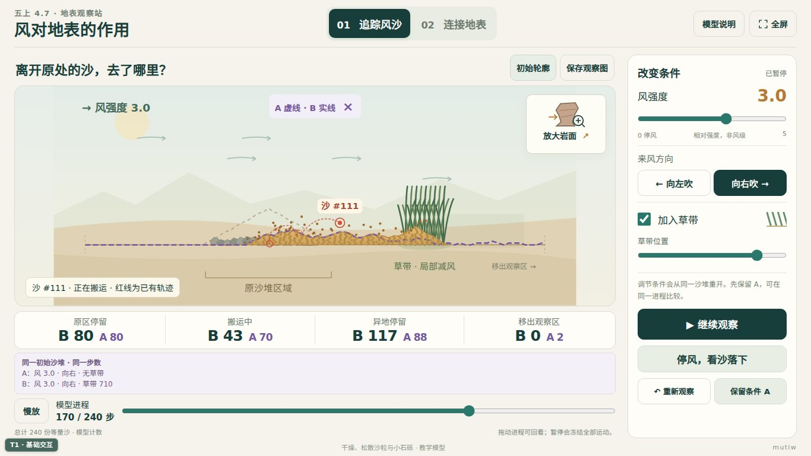

# 五上4.7《风对地表的作用》

**v1.0 · 地表观察站 · 单体 HTML**

[打开互动网页](index.html)

已核实项目教材印刷页122—125（PDF第126—129页）及对应教师教学用书。保留吹沙实物实验，用数字模型补充难以连续观察的颗粒去向、累计磨蚀和前后对照，支持学生依据观察解释地表变化。

## 两个工作区与岩面放大窗

- **追踪风沙**：点选沙粒查看轨迹，比较原地、空中、异地和画面外的等量沙单元；保留初始轮廓，观察侵蚀、搬运与沉积的联系。
- **放大岩面**：并列观察无沙与含沙气流，查看各高度累计撞击和岩面退缩；换侧来风保留已有痕迹，把短时撞击与长期形态变化联系起来。
- **连接地表**：学生拖动节点、建立有向连接并选择关系词，可补充温度和植物、保留初图再修订。不自动判定科学解释是否正确。

## 如何操作

1. 调整风强度、方向或草带，点击“开始吹风”。改变条件会从同一沙堆重开；先“保留条件 A”，即可在同一进程比较条件变化。
2. 暂停、慢放或拖动进程回看；“停风，看沙落下”让空中沙继续运动至落下或离开画面。“重新观察”复位当前条件，保留 A。
3. 点击“放大岩面”观察磨蚀；支持暂停、回溯、换向与复位。
4. 在“连接地表”中切到“连线”，依次点两个节点并选词；可改词、删线、撤销和查看初图。

观察图、岩面对照图及关系图均可导出 SVG。前两类导出的是模型状态，留有观察解释位置；关系图在浏览器允许时自动保存在本机。

## 模型边界

- 固定干燥、松散沙与小石砾；240份等量沙单元用于去向计数，非真实沙粒数。未模拟湿度、黏结和结皮；移出画面的沙单列，不凭空消失。
- 草带仅以局部减风表示影响，未模拟根系、植被种类或真实湍流。
- 风强度0—5是相对模型量，不是真实风速或气象风级；作用步与撞击数均为模型计数，不换算地质年代。
- 岩面形变放大、加速，只表示同材料下相对磨蚀。低处沙粒较多不表示低处风速更大，也不意味着所有岩石都形成同一外形。模拟不能独立验证其预设规律。

## 下载、验证与维护

下载本目录的 `index.html`，直接用浏览器打开即可离线运行，无外部运行依赖；参考链接需联网。课堂吹沙仍应按教材要求佩戴护目镜。

已用 Chromium 153 实际验证离线加载、暂停回溯、A/B对照、模型计数守恒、边界输出、岩面换向、SVG下载、关系图编辑与本机保存；无脚本错误或外部运行请求。检查尺寸为1920×1080、1366×768、1024×768、768×1024、390×844：无横向溢出，前四种核心操作一屏可用，手机纵向滚动。关系图已做浏览器模拟触控点击与拖动；未在真实 iPad 或希沃设备上实测。

维护入口均在单文件脚本内：`buildSand` 管理输沙状态与历史，`buildRock` 管理撞击和累计磨蚀，`ConceptMap` 管理关系图、存储与导出。修改模型时同步检查动画、计数和回溯结果。

科学参考：[NPS · Aeolian Features and Processes](https://www.nps.gov/articles/aeolian.htm)。
