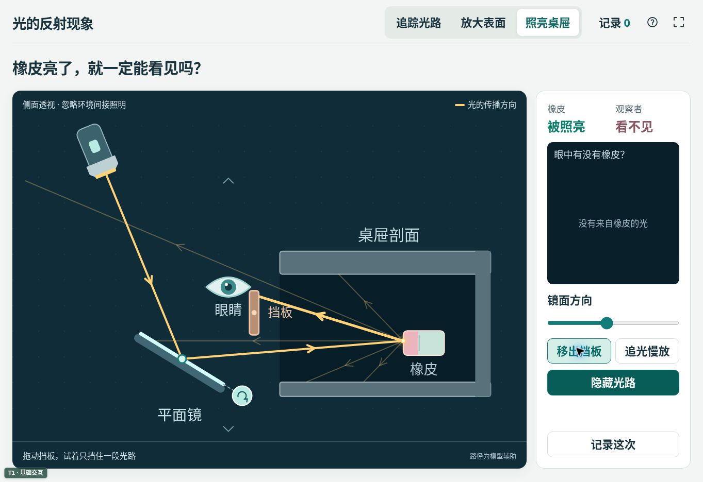

# 六上2.4 光的反射现象

本课互动网页配合教科版六年级上册第二单元第4课使用。它把实物实验中难以同时看清、保留和比较的光路展开，让学生用自己的预测和实验记录解释光的传播。课堂仍以窄缝光束、平面镜、水槽以及桌屉找橡皮等实物活动为基础。

核心问题是：**改变镜面的方向，光会往哪里去？橡皮被照亮以后，为什么还可能看不见？**

## 教学定位

- 从旋转镜子和观察光斑的经验出发，预测、验证并比较反射路径。
- 将平整与粗糙表面放大为可观察的几何模型，解释普通物体为什么也能把光反射到不同方向。
- 在桌屉剖面中追踪“光源→镜子→橡皮→眼睛”，区分照亮物体与看见物体两个条件。
- 用可回看的记录支撑口头解释和记录单绘图，保留学生的实物观察及其与模拟的差异。

## 三个互动场景

| 场景 | 学生操作 | 数字技术补充的观察视角 | 建议追问 |
| --- | --- | --- | --- |
| 追踪光路 | 旋转镜子，画出自己的预测线，再显示模型光路；保留一组状态，与当前状态叠加比较。法线和角度默认关闭，可按需展开。 | 把转动前后的镜面姿态和光路放在同一画面中比较；预测线保留到验证后，便于解释与修正。 | 镜子只改变一点，光斑会往哪边移动？你依据什么预测？ |
| 放大表面 | 拖动调节粗糙程度，比较同一组平行光照到平整表面与多个局部小面后的去向。 | 放大肉眼看不清的表面起伏，将普通物体的反射与平面镜反射建立联系。 | 光向不同方向离开，是因为光随意转弯，还是因为照到的小面朝向不同？ |
| 照亮桌屉 | 调节镜子，移动眼睛与挡板，观察照明和可见性的变化；显示完整路径，按需慢放。 | 用桌屉剖面同时看清光源、镜子、橡皮与眼睛之间的路径，并分别遮挡不同路径检查原因。 | 橡皮还亮着，为什么这个位置的眼睛看不见？光在哪一段被挡住了？ |

网页中的可见路径、表面放大和传播慢放均为帮助解释的模型视角。学生在实物实验中获得的现象和记录，应与模型结果一起讨论。

## 记录和比较

全局最多保留4组记录，可选择其中2组对照。记录支持浏览器本地保存，以及SVG和CSV导出，便于回看路径、比较条件和整理课堂证据。

- 模拟数据来自网页模型，只能作为模型结果使用。
- 实物观察由教师根据课堂实际填写；未填写时保持未记录状态，不自动生成或补齐“实测数据”。
- 实物观察与模拟结果应保留来源区分。二者不一致时，先检查光束宽度、镜面位置、环境光、遮挡和记录方法，再讨论模型的简化。
- 本地记录不跨设备自动同步。清除浏览器网站数据、使用不同浏览器或不同访问地址，可能无法读取原记录；需要保留的内容请及时导出。

## 40分钟课堂中的使用建议

建议把网页安排在实物观察之后的关键解释环节，合计使用约8—12分钟。下表给出其中一种40分钟安排，网页实际使用约10分钟；教师可根据实验准备和班级情况调整。

| 时间 | 教学活动 | 网页使用 |
| --- | --- | --- |
| 0—4分钟 | 以桌屉里的文具看不清为情境，交流让光照进去的设想。 | 暂不显示模型结论。 |
| 4—16分钟 | 开展窄缝光束、转动平面镜及水中观察光路的实物活动，画出至少两种情况。 | 以实物和记录单为主。 |
| 16—20分钟 | 对比学生画法，先预测，再验证与修正。 | 场景一：保留一种镜面状态，再改变镜面进行叠加比较。 |
| 20—22分钟 | 讨论橡皮、纸和桌面是否也会反射光。 | 场景二：放大表面，比较光的去向；不安排角度计算。 |
| 22—29分钟 | 用平面镜照亮桌屉中的橡皮，交流摆放方法。 | 回到实物操作。 |
| 29—33分钟 | 检查“照亮就一定能看见”的解释，分别遮挡照明与观察路径。 | 场景三：移动眼睛、挡板，必要时使用慢放。 |
| 33—40分钟 | 学生画出并讲述完整光路，联系生活中的反射现象，按时间开展双镜观察。 | 按需回看两组记录，不必再次完整演示。 |

如果课堂时间较紧，可只使用场景一的前后比较和场景三的遮挡解释。场景二也可在学生问到“橡皮又不是镜子，为什么能反射”时短暂进入。

## 科学模型与教学边界

### 光路和镜面

网页采用二维几何光学模型，以带方向的线表示代表性光路。镜面反射按入射方向与局部表面朝向计算；光应先与反射面相交，再改变方向。法线是帮助描述方向的辅助线，不是实际存在的一根线。

光路的显示并不表示清洁空气中可以天然看见整条光束。实物中的可见光路与光被散射到观察者眼睛有关；本网页把路径显示出来，是为了比较和解释。

角度显示服务于观察和解释，不作为本课必须掌握的量角计算任务。教师用书明确指出，小学阶段不要求学生精准画出入射角等于反射角，路径大致合理即可；对方向性错误，应结合实物操作讨论和修正。

### 表面粗糙程度

粗糙表面采用“不同朝向的局部小面”近似。每个小面的反射仍遵循相同规律，反射方向分散来自局部朝向的差异，不能解释成光任意改变方向。

画面只呈现少量代表光线和放大后的表面模型，不表示真实微观结构、光线总数或光能分布。本模型不计算波动光学、偏振、材料光谱、细致散射分布或真实表面材质。

### 照亮和看见

看见不发光物体，需要有光到达物体，并有来自物体的光进入眼睛。挡住“橡皮→眼睛”的路径时，橡皮仍可被照亮，但该观察位置不能通过这一路径看见它；挡住照明路径时，橡皮则无法受到该光路的照明。

橡皮受光点向其所在面的前半空间多个方向反射光，画面只选择其中一些路径帮助说明。桌板、挡板和环境的弱间接照明被忽略；右侧图标只表示收到来自橡皮的光，不模拟成像或真实受光面积。眼睛作为接收光的部位，不向物体发出观察光线。桌屉采用剖面表示，几何遮挡关系优先于写实外观。

传播慢放仅展示先后关系，不按真实光速或真实时间比例播放。画面中的颜色、亮度、线宽和光斑用于辨认状态，不作为照度、光功率或距离的实测值。

## 教材依据

依据本项目所附材料核对：

| 资料 | 页码 | 本网页对应内容 |
| --- | --- | --- |
| 《科学》六年级上册教材 | 印刷第46—49页，附件PDF第50—53页 | 窄缝光束与镜面反射、水中观察光路、照亮桌屉橡皮、完整路径研讨。 |
| 《科学教师教学用书》六年级上册 | 第178—179页 | 科学观念、路径预测与实际问题解决的教学目标和重点。 |
| 同上 | 第181—183页 | 反复改变镜面比较路径；普通物体表面的反射；镜子到橡皮再到眼睛的解释。 |
| 同上 | 第184—185页 | 至少记录两种镜面情况；先画镜子位置，再依次画入射与反射路径。 |
| 同上 | 第187页 | 不要求小学阶段精准量角绘图，合理路径与方向判断优先。 |
| 《六上说明书》 | 印刷第11—12页，附件PDF第8页 | 光的反射卡、旋转平面镜、预测并标记光斑和双镜观察的实验方法。 |

以上资料用于教学设计核对。网页图形由代码绘制，教材和教师用书扫描页不作为发布素材嵌入。

## 技术与兼容目标

- 交付为可直接打开的单体HTML，优先使用SVG和原生JavaScript交互。
- 按项目T1基础兼容层设计；离线运行，不依赖外部CDN、网络字体或远程图片。
- 适配电脑、希沃一体机和学生平板，支持鼠标与触控。核心场景在一屏内呈现。
- 课堂页面以实验图形和必要操作为主，学校及作者署名仅在项目目录入口呈现，不在课件内部重复显示。
- 不申请摄像头、麦克风或定位权限，不向服务器上传课堂记录。
- 兼容等级是设计目标，不代表已在所有设备上完成实机验证。具体已验证的浏览器、视口和操作，应以本课发布时的实际验证记录为准。

## 后续素材与模型替换

视觉绘制、物理计算和记录导出应保持分离，替换素材时保留对象的坐标、交互区域及光路计算接口。内嵌脚本按以下职责分离，`window.ReflectionLab` 提供模型与绘制接口。

| 实际接口名称 | 职责 | 后续可调整内容 |
| --- | --- | --- |
| `sceneSVG / Art.eraser / Art.eye` | 绘制光源、镜子、桌屉、橡皮和眼睛。 | 优化二维形状、颜色与材质，保留关键几何锚点。 |
| `Models.surface / microSVG` | 提供平整及粗糙表面的局部小面和法线。 | 调整表面起伏模型，保持反射计算与显示一致。 |
| `LightGeometry / Models.bench / Models.drawer` | 计算交点、反射与遮挡。 | 扩展光束采样或多次反射，不能以视觉动画代替物理判断。 |
| `saveRecord / cleanData / persist` | 保存模拟条件、预测、结果与实物观察来源。 | 扩展记录字段，同时兼容已有本地记录。 |
| `exportSVG / exportCSV` | 生成SVG图示与CSV记录。 | 调整导出布局和字段，保持来源标识及数据语义。 |

## 已完成验证

- 两段内嵌JavaScript语法检查通过；无外部运行资源，HTML约67KB。
- 统一几何函数的反射、交点、优先遮挡、平行线和零向量边界检查通过；逐面反射采用实际小面朝向。
- 针对桌屉的七个回归情形通过：默认未照亮、对准后照亮且看见、遮挡去程、遮挡回程、眼睛过高、眼睛过低、受光面背侧没有不合理的穿入光线。
- 云端Chromium实际操作通过：镜面拖动、预测线、路径显隐、旧镜面和光路叠加、平整与粗糙切换、保存记录、挡板拖动、眼睛键盘微调、传播慢放和记录窗口。
- 同一浏览器通过固定尺寸iframe检查三个场景的1920×1080、1366×768、1024×768、768×1024和390×844视口：文档滚动尺寸与视口一致，主要按钮、滑块和实验区域均未超出视口。
- 正式HTTPS页面实际下载了SVG与CSV，解析确认XML有效、CSV字段完整，逗号、引号、尖括号及换行保留，实物观察保持“未记录”。另用4组、140字解释检验导出函数；SVG按实际文本行数伸展，避免多行解释裁切。
- 当前云端浏览器中的课件脚本未出现错误；浏览器扩展自身的日志不属于课件错误。

视口检查不等于希沃、实体触控或旧iPad/Safari实机认证。这些设备仍建议课前现场试用。页面提供Pointer Events，并在缺少时回退至鼠标/触摸事件；全屏不可用时给出提示。

## 本机记录保护修订（待发布）

本次仅修复本机缓存保护，不改变光学模型、课时归档、许可或原版快照。完整校验现有记录；遇到坏 JSON、未知字段、缺失字段、超量或越界数据时，不清洗、不截断、不覆盖原档。当前页面仍可独立操作。保存前比较原始字符串，并监听其他页面的存储变更。失败状态通过常驻“记录未保存”入口保留，不被普通操作提示遮盖。

需要替换异常或冲突档时，先下载包含原始档案、最新档案和当前页面记录的备份，核实文件落盘后勾选确认，再显式替换。备份仅供保全，没有自动导入功能；不要公开或上传个人记录。不创建额外的持久副本，不发送记录到网络。关闭页面前请处理“未保存”提示。

验证范围：隔离 Node 故障测试与语法检查；浏览器正常交互验收另由统筹完成。未在本轮取得教材或教参原件，不声称完成原件核验。
