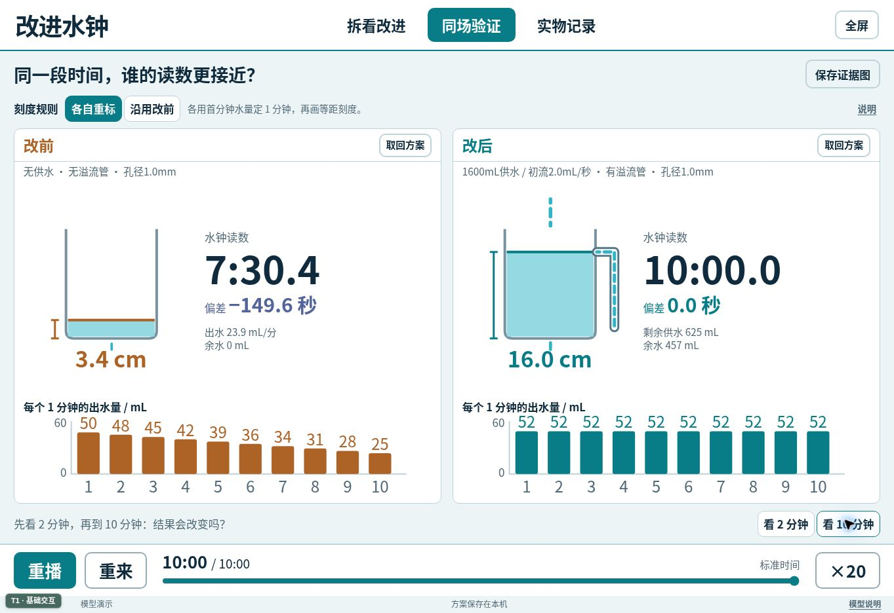

# 六上4.4《改进水钟》互动实验室

[在线打开](https://mutiwangn.github.io/AI-html/六上4.4改进水钟/) · [下载单体 HTML](./六上4.4改进水钟_v1.0.html) · [返回课程总览](../)

本课对应教科版六年级上册第四单元《计量时间》第4课，教材第110—113页、教师用书第343—352页。版本：v1.0。采用 HTML、CSS、JavaScript 和 SVG，技术等级为 **T1 基础交互**；页面内不加载外部脚本、字体或图片，下载后可以离线打开。



## 教学目标与数字互动的作用

学生在已有实物水钟的基础上，识别影响计时的变量，提出并保留改进方案，通过同一标准时间下的读数比较判断改进效果，再用真实作品检验解释。

网页补充实物活动中难以同步呈现的观察：把供水壶、出水壶、溢流管和受水杯同时透视；把整个10分钟过程压缩、暂停并回看；将同一时刻的结构、水位、流量、累计读数与每分钟出水量关联起来。模型用于提出和检验解释，实物制作、标刻与测量仍是课堂证据的重要来源。

| 工作区 | 学生实际可以做什么 | 主要证据 |
| --- | --- | --- |
| 拆看改进 | 拖动初始水位线；安装或取下供水壶、溢流管；调节出水孔、初始供水速度；切换宽、细受水杯；保存改前和改后方案 | 水位与出水速度的联动，以及水进入受水杯或余水杯的不同去向 |
| 同场验证 | 两个保存的方案在同一标准时间下运行；暂停、拖动时间条、跳到2分钟或10分钟；切换刻度规则；取回方案继续改进；保存SVG证据图 | 两组读数、偏差和每个1分钟的出水量；观察前段表现能否延续到后段 |
| 实物记录 | 在标准计时器到120秒或600秒时，分别录入改前、改后的三次水钟读数；填写改进理由与证据；导出CSV | 每次误差、三次平均绝对误差、三次读数极差；保留真实重复测量的差异 |

## 建议的问题链：从2分钟快测走向10分钟检验

1. **先用真实水钟快测2分钟。** 标准计时器到120秒时，水钟显示多少？是读数整体偏快、偏慢，还是每次结果不一样？先记录，不用模型数值填入实测表。
2. **拆看并提出一个改进。** 水面到出水孔的高度有没有变化？供水进入哪里？多余的水去了哪里？一次尽量只改一个条件，保存改前、改后方案。
3. **在模型中比较同一段2分钟。** 两个方案用哪一种刻度规则？两分钟末的偏差相近，是否表示后续也相近？保留学生的预测。
4. **把观察延长到10分钟。** 对照每分钟出水量，回看变化开始的时刻。供水壶是否在完全流空前就已经供水不足？如果受水杯满了，还能继续据其水位读时吗？
5. **回到实物复测。** 用同样的标准时间进行改前、改后各三次测量；条件允许时再测600秒。用“我们改了……因为……证据是……”说明判断，并讨论还需改进的地方。

2分钟快测用于快速发现和修改，10分钟检验用于考察持续表现。一次恰好接近标准时间不能代替重复测量，也不能单独证明全过程流量稳定。

## 刻度规则必须说清楚

本页采用本课关注的**等距刻度**：在一套相同初始条件的独立标定过程中，收集第一个60秒的水，把这段水位增量定为“1分钟”，再等距延长刻度；正式对照时补回初始水位，从零重新开始。

- **各自重标**：改前、改后分别用各自首分钟的水量标定。因此模型在各自的标定点读作60秒是刻度定义的结果，后续读数是否准确仍需检验。
- **沿用改前**：两台水钟沿用改前尺上的实际刻度间距，换受水杯也不重画尺子。如果受水杯横截面积变小，同一水量带来的水位升高更大，沿用原间距会改变读时；这不表示上方出水速度随之变快。

模型偏差的统一定义为：**水钟读数 − 标准时间**。正值表示读数偏快，负值表示读数偏慢。

实际装置也可以逐分钟测量后绘制不等距刻度，以补偿流量变化。本页没有把“流速变化的水钟”一概判为不能计时；这里的比较限定在上述等距刻度规则之内。

## 可以控制的条件与失效情况

| 条件 | 本版设置及含义 |
| --- | --- |
| 初始水位 | 可拖动设置6—18厘米；改变后从时间零重新运行 |
| 出水孔直径 | 0.6—1.4毫米，连续分档调节 |
| 供水量 | 0、400、1600毫升；0表示取下供水壶，另外两种都是有限水量 |
| 初始供水速度 | 0.6—3.0毫升/秒，与初始供水量分开设置；运行中随供水壶水位下降而减小 |
| 溢流管 | 溢流口固定在16厘米；按通畅且排量足够的理想溢流口处理，只能排走多余水，不能补水 |
| 受水杯 | 宽杯截面积30平方厘米、细杯15平方厘米，模型有效杯高均为40厘米；容量分别为1200、600毫升 |

安装溢流管后，只有补水足以补偿出水时，出水壶才可能保持在溢流高度。有限供水可以先变得不足，随后才完全流空；供水不足后水位会下降。没有溢流管时，过量来水可能使水位升高并从杯沿溢出，模型分别统计这部分水。

受水杯满后，流入的水继续计入守恒账目，但无法再靠该杯水位形成有效计时读数，界面显示读数无效。换细杯会使水位更容易分辨，同时更早达到容量上限；它本身不改变上方孔口的出水速度。

## 模型条件与科学来源

出水壶使用简化孔口出流关系：

```text
Q = Cd × A孔 × √(2gh)
```

`h` 为水面到出水孔的高度，`A孔` 为出水孔面积，`g=981 cm/s²`。本版将有效流量系数 `Cd` 固定为0.62。下列大学讲义给出了孔口出流关系和薄板小孔收缩系数约0.62；这里把0.62用作固定有效出流系数，是用于比较趋势的教学简化，并非所有塑料瓶孔、吸管或真实装置的标定结果。

有限供水壶按恒定截面、重力出流处理，设初始水量为 `S0`、初始供水速度为 `q0`：

```text
S(t) = S0 × max(0, 1 − q0 × t / (2S0))²
q入(t) = q0 × √(S(t)/S0)
```

模型假设自由液面与出口处通大气、出口未被受水杯水淹没、容器截面恒定。它没有精细模拟黏性随条件变化、表面张力、滴水形成、孔形差异、实际管路阻力、气泡、浮标摩擦、液面波动和蒸发。水流动画不代表逐滴计数；容器示意图之间也不使用同一几何比例。真实小孔、低水位或较长细管可能显著偏离本版简化关系。

来源：

- 教科版六年级上册《改进水钟》：本项目提供的教材第110—113页、教师用书第343—352页。
- Richard Fitzpatrick，The University of Texas at Austin：[Flow Through an Orifice](https://farside.ph.utexas.edu/teaching/336L/Fluid/node55.html)。用于核对孔口出流与水头关系、薄板小孔的收缩现象。
- James F. Price，MIT OpenCourseWare：[Draining a Tank — Appendix to Dimensional Analysis of Models and Data Sets](https://ocw.mit.edu/courses/res-12-001-topics-in-fluid-dynamics-fall-2024/mitres_12_001_f24_appendix.pdf)。用于核对表面张力、黏性和管路条件造成的真实流动偏差。

## 实物记录与模型数据分开

“实物记录”的所有读数初始为空，只接受手动输入的真实水钟读数，不会从模型自动填入。120秒和600秒各有独立的改前、改后三次记录以及解释文字，切换目标时长不会清空另一组。

每次误差按“读数减标准”计算；同一阶段三次齐全后显示平均绝对误差和极差。极差是这组三次重复读数的最大值减最小值，描述重复结果的离散程度，不是对瞬时流量稳定性的直接测量。

导出的CSV包含两个目标时长共12行记录，明确标注“实测（人工录入）”；未填的读数保持空白。文件使用UTF-8 BOM，并对解释文字进行CSV引号转义和公式注入防护。

## 离线运行、保存与导出

打开 `index.html` 或下载文件 `六上4.4改进水钟_v1.0.html` 即可运行，两份HTML内容相同。所有运行所需样式、脚本和SVG均已内嵌；README截图与外部参考链接不参与课件运行。

- 点击“全屏”进入课堂展示；浏览器不提供全屏接口时可使用浏览器菜单。
- 模型可开始、暂停、重来，并以1倍、5倍、20倍演示；时间条支持0—600秒回看。
- “记为改前”“记为改后”保留方案，“取回方案”可继续修改；改变设计参数会重置本轮模型时间。
- “保存证据图”导出SVG，保留两组方案条件、当前标准时间、读数、偏差和已经过时段的逐分钟出水量，并标明是模型证据。
- “导出实测CSV”保存两组人工记录；本机保存失败时仍可操作与导出。

方案和实测记录使用不同的 `localStorage` 键，只保存于当前浏览器，不上传数据。更换浏览器、清理站点数据或某些浏览器的本地文件限制可能影响保存；需要长期保留的课堂证据应导出文件。

## 后续模型替换接口

单体HTML内的水流计算与SVG绘制分离。后续可替换 `window.WaterModel`，保留以下接口和单位约定，避免改动课堂流程及记录模块：

| 接口 | 作用 |
| --- | --- |
| `normalize(config)` | 校验并补齐配置 |
| `compute(config)` | 返回整段仿真的配置、逐秒样本、标定量、逐分钟水量和元信息 |
| `sampleAt(result, seconds)` | 取指定标准时间的样本，支持分数秒插值 |
| `outflowRate(headCm, holeMm, Cd)` | 返回毫升/秒出水量 |
| `sourceVolumeAt(config, seconds)` | 返回供水壶剩余毫升数 |
| `sourceFlowAt(config, seconds)` | 返回当前供水速度 |

长度使用厘米、体积使用毫升、时间使用秒，孔径单独使用毫米。`compute` 返回值应保留 `config`、`samples`、`calibrationMl`、`calibrationValid`、`minuteVolumes`、`minutes`、`metadata`；样本应保留水头 `h`、供水及收集体积、各去向溢流量、入流/出流速度、读数与有效性等字段。SVG装置绘制可独立换成更精细的容器、管路或浮标素材，不应改变物理量含义。

## 已完成验证与设备范围

已完成9项独立数值检查：自由排水与解析解一致；首分钟标定与后续偏差；充足供水保持水位；有限供水不足及流空；无溢流管的杯沿溢流；弱供水无法维持水位；受水杯溢出与守恒；堵孔及开始前溢流处理；减半积分步长的收敛性。检查包含水量守恒以及读数失效条件。

实物记录另已检查空值与零值区分、三次平均绝对误差与极差、120/600秒分组保存、CSV空白值与公式转义、损坏本机记录的回退。浏览器CSV下载已实测完成，文件包含表头及12行数据；测试读数117/116/118秒与120/119/121秒，对标准120秒得到平均绝对误差3.0/0.7秒、极差2.0/2.0秒，结果正确。该测试数据没有预填进交付页面。

SVG导出调用已检查未产生JavaScript错误；当前云浏览器环境尚未回报文件下载结果，暂不将其列为已通过实际文件下载验证。

| 浏览器检查尺寸 | 状态 |
| --- | --- |
| 1920×1080 | 已进行布局与交互检查 |
| 1280×720 | 已进行布局与交互检查 |
| 1024×768 | 已进行布局与交互检查 |
| 390×844 | 窄屏装置重排已复核，三页主要控件无屏外溢出 |

上述检查属于浏览器环境验证。**真实希沃一体机和旧款iPad尚未实机测试**，T1登记表示最低技术需求，不代表所有设备已通过实际性能与触控验证。
