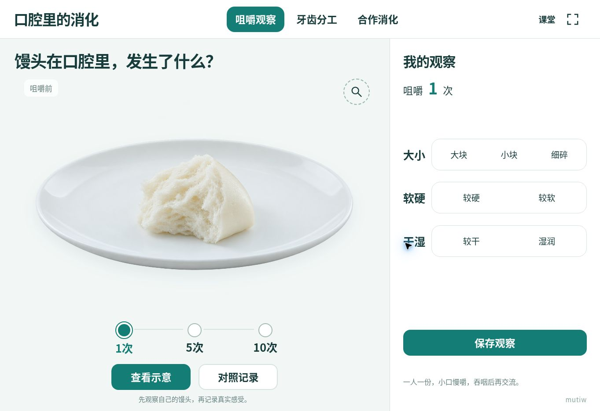

# 四上2.5《口腔里的消化》互动实验室 v1.0

直接打开 `index.html`，即可在一体机、电脑或学生平板使用。HTML 内含全部样式、程序和图片，独立教学功能无外部运行依赖。

## 三个主页面

| 页面 | 课堂用途 | 交互 |
| --- | --- | --- |
| 咀嚼观察 | 在真实体验中记录咀嚼1、5、10次后的大小、软硬与干湿 | 切换观察节点、填写与对照记录、放大馒头、按需查看示意、补充发现、导出 |
| 牙齿分工 | 联系牙齿的位置与形状推测功能 | 点选门齿、犬齿、臼齿；预测切断、撕裂、磨碎；播放对应动作 |
| 合作消化 | 解释牙齿、舌与唾液怎样共同作用 | 暂停某项作用进行比较、重置观察；打开刷牙方向示意和3分钟计时 |

观察记录与模拟完全分离，不按动画自动填写答案。软硬使用“较硬／较软”状态词，方便记录馒头本身的柔软情况。1、5、10次是观察节点，不是吞咽标准。

## 教学依据与模型边界

依据本项目提供的四年级上册《教师用书》第二单元第5课《口腔里的消化》及《教材》印刷页42—44。

- 门齿切断，犬齿撕裂，臼齿磨碎；舌运送、搅拌；唾液湿润食物。
- 教师用书明确本课不需要展开淀粉酶机制。口腔完成的是初步消化。
- 图中的牙齿数量、口腔局部结构、食物大小和动作速度均为教学示意，不作为解剖计数、医学测量或吞咽建议。
- 上牙保持固定，下颌合拢；只有进入臼齿位置且合拢接触时才累计粉碎。暂停舌后，未送到齿间的食物从初始画面就保留，不会凭空增加。
- 刷牙方向和“不少于3分钟”按本课教材呈现。
- 盘中馒头为生成素材；齿形、功能动作与合作模型使用可核对的原生SVG。

## 局域网课堂

下载并解压 [口腔消化局域网课堂_v1.0.zip](./口腔消化局域网课堂_v1.0.zip)。教师电脑需要 Python 3.8 或更新版本。

1. Windows 双击 `server/启动课堂.bat`；macOS 运行 `server/启动课堂.command`。
2. 教师与学生均打开启动窗口提供的课堂网址。教师创建课堂后，学生输入六位课堂码并选择小组。
3. 支持教师增减小组、小组上传真实观察和一张过程照片、教师点评与重点证据展示、含照片的离线HTML档案导出。

GitHub在线页和双击HTML均可独立教学；跨设备互联需要本地服务，单靠同码不能联网。学校Wi-Fi需允许设备互访。课堂数据与照片保存在服务内存中，关闭服务或关机前请导出。

详细启动与数据说明见 [server/使用说明.md](./server/使用说明.md)，接口见 [server/API_CONTRACT.md](./server/API_CONTRACT.md)。

## 修改与构建

修改 `parts/` 中的HTML、CSS和JavaScript后运行 `python build.py`，重新生成单体 `index.html`。图片位于 `assets/mantou-plate.png`，构建时自动嵌入。无需 npm 安装或构建依赖。

## 验证说明

核心页面经过浏览器交互与常见横竖屏尺寸检查；服务端经过59项完整HTTP处理器、记录、照片和权限检查。学校的实际Wi-Fi和希沃设备需要在现场确认，不将接口桩的浏览器测试当作真实局域网连接证明。

页面仅保留 `mutiw` 水印；学校及教师署名在仓库课时目录显示。

## 2026-11 记录存储保护

保留教学功能、既有存储键与有效历史记录。异常结构不静默清除或部分读取后覆盖，提供备份或临时草稿；配额或权限失败明确反馈，不冒称已保存。备份用于人工恢复，不保证自动导入。旧版保留在 Git 历史，不强制刷新正在使用的旧页。关闭页面前请先导出或复制未保存内容。

正常记录与重载恢复经过云 Chrome 测试；损坏结构、配额和读取拒绝通过隔离脚本测试，未在浏览器注入故障。2.5、2.7 的备份内容经脚本核验，制作阶段浏览器点击后未复读落盘文件；2.6、2.8 的异常提示及备份仅经隔离测试。2.5 课堂身份会话模块不在本次观察数据修复范围。实体希沃和 iPad 未实测，原兼容等级不变。
